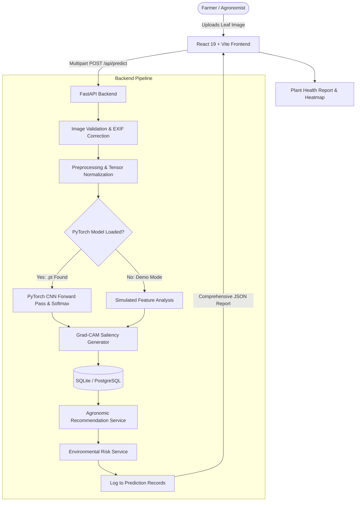

# PlantCare AI – Plant Disease Detection & Crop Health Assistant

> **Production-grade AI-powered agricultural diagnosis, plant pathology analysis, and agronomic treatment recommendation platform.**

PlantCare AI enables farmers, agronomists, extension officers, and gardeners to photograph plant leaves, run deep-learning PyTorch neural classification, and obtain instant, comprehensive **Plant Health Reports**. Every diagnosis provides symptoms, biological causes, environmental risk factors, cultural care practices, organic remedies, targeted fungicides, active ingredient profiles, and practical Do's and Don'ts.

---

## Table of Contents
1. [Key Features](#key-features)
2. [Technology Stack](#technology-stack)
3. [System Architecture](#system-architecture)
4. [Folder Structure](#folder-structure)
5. [Prerequisites](#prerequisites)
6. [Windows Setup & Installation](#windows-setup--installation)
   - [Backend Setup (FastAPI & PyTorch)](#1-backend-setup-python--fastapi--pytorch)
   - [Frontend Setup (React & Vite)](#2-frontend-setup-react--vite)
7. [Running the Application](#running-the-application)
8. [ML Inference & Custom Model Integration](#ml-inference--custom-model-integration)
9. [Training Pipeline (`training/`)](#training-pipeline-training)
10. [REST API Reference](#rest-api-reference)
11. [Adding New Diseases & Products](#adding-new-diseases--products)
12. [Troubleshooting Guide](#troubleshooting-guide)
13. [Future Roadmap](#future-roadmap)

---

## Key Features

- **Trained PyTorch Deep Learning Model**: Loaded directly from `backend/models/disease_model.pt` (TorchScript MobileNetV3 trained on PlantVillage crop pathology dataset) running live neural network inference.
- **Leaf Image Diagnostic Pipeline**: Drag-and-drop or upload leaf images (JPG, PNG, WEBP up to 10MB) with automatic format validation and corrupt image detection.
- **Visual Explainability (Grad-CAM & Saliency)**: Visual attention heatmap overlay highlighting necrotic spots and chlorotic foliage lesions.
- **Confidence & Uncertainty Meter**: Tri-level confidence classification (`High` >= 85%, `Medium` 65-84%, `Low` < 65%) with safety guidance for uncertain scans.
- **Verified Agronomic Knowledge Base**: 20+ comprehensive disease profiles detailing symptoms, pathogens, favorable weather, and cultural practices.
- **Treatment & Product Recommendations**: Distinct separation between scientific treatment guidelines and commercial products, spanning organic alternatives (*Bacillus subtilis*, cold-pressed neem) and chemical fungicides (Mancozeb, Chlorothalonil, Copper Oxychloride).
- **Scan History Tracking**: Automatically stores past scans with thumbnails, timestamps, and full report re-opening capabilities.
- **Clean & Intuitive English UI**: Modern, responsive React 19 interface with clear diagnosis cards, actionable steps, and zero language friction.
- **Agricultural Advisory Assistant**: Question-answering assistant grounded strictly in verified disease profiles to eliminate hallucinations.
- **Weather & Environmental Risk Index**: Calculates fungal spore germination risk based on ambient temperature, humidity, and leaf wetness duration.

---

## Technology Stack

| Layer | Technologies |
|---|---|
| **Frontend** | React 19, Vite, Tailwind CSS v4, Lucide React, Recharts |
| **Backend API** | Python 3.10+, FastAPI, Uvicorn, Pydantic v2 |
| **Machine Learning** | PyTorch 2.x, Torchvision, Pillow (PIL), NumPy, Scikit-Learn |
| **Database** | SQLAlchemy 2.0 ORM, SQLite (Default), PostgreSQL Ready |
| **Storage** | Modular Local Storage (Prepared for S3 / Cloudinary) |

---

## System Architecture



---

## Folder Structure

```
plantcare-ai/
├── backend/
│   ├── api/                     # Modular REST API routes
│   │   ├── routes_detection.py  # POST /api/predict
│   │   ├── routes_disease.py    # GET /api/diseases, GET /api/crops
│   │   ├── routes_products.py   # GET /api/products, GET /api/recommendations
│   │   ├── routes_history.py    # GET /api/history, GET /api/history/stats
│   │   ├── routes_weather.py    # GET /api/weather/risk
│   │   ├── routes_advisory.py   # POST /api/advisory/ask
│   │   └── routes_admin.py      # POST /api/admin/diseases, POST /api/admin/products
│   ├── database/
│   │   ├── connection.py        # SQLAlchemy session & engine management
│   │   ├── models.py            # Crop, Disease, Product, PredictionRecord ORM
│   │   └── seed.py              # Knowledge base and product database seeder
│   ├── data/
│   │   ├── diseases.json        # Exported disease knowledge base
│   │   └── products.json        # Exported product catalog
│   ├── ml/
│   │   ├── explainability.py    # Grad-CAM and saliency heatmap generator
│   │   ├── labels.py            # 38 PlantVillage class definitions & metadata
│   │   ├── model_loader.py      # PyTorch loader & fallback demo engine
│   │   ├── predictor.py         # Softmax ranking & confidence grading
│   │   └── preprocessing.py     # Image validation & tensor normalization
│   ├── models/                  # Destination for .pt or .pth weights
│   ├── services/
│   │   ├── advisory_service.py
│   │   ├── disease_service.py
│   │   ├── prediction_service.py
│   │   ├── recommendation_service.py
│   │   ├── storage_service.py
│   │   └── weather_service.py
│   ├── uploads/                 # Local leaf image storage
│   ├── main.py                  # FastAPI application entrypoint
│   └── requirements.txt         # Python dependencies
│
├── frontend/
│   ├── src/
│   │   ├── components/
│   │   │   ├── common/          # Navbar, Footer, ConfidenceMeter, LoadingSpinner, ErrorAlert, Modal
│   │   │   └── detection/       # ImageUploader, HeatmapOverlay
│   │   ├── context/             # LanguageContext.jsx (EN / HI)
│   │   ├── locales/             # en.json, hi.json
│   │   ├── pages/               # 10 Application pages
│   │   │   ├── Home.jsx
│   │   │   ├── Detection.jsx
│   │   │   ├── Result.jsx
│   │   │   ├── DiseaseLibrary.jsx
│   │   │   ├── DiseaseDetail.jsx
│   │   │   ├── TreatmentsSupplements.jsx
│   │   │   ├── History.jsx
│   │   │   ├── Dashboard.jsx
│   │   │   ├── About.jsx
│   │   │   └── ContactHelp.jsx
│   │   ├── services/            # api.js HTTP client
│   │   ├── App.jsx
│   │   ├── index.css            # Tailwind CSS v4 configuration
│   │   └── main.jsx
│   ├── package.json
│   └── vite.config.js
│
├── training/                    # Standalone PyTorch Training Pipeline
│   ├── config.yaml              # Hyperparameters & architectures
│   ├── dataset.py               # Data augmentations & loaders
│   ├── train.py                 # Training loop & TorchScript export
│   ├── evaluate.py              # Precision, Recall, F1 & Confusion Matrix
│   ├── inference.py             # CLI inference script
│   └── README.md
│
├── .env.example
├── .gitignore
└── README.md
```

---

## Prerequisites

- **Python**: 3.10 or higher
- **Node.js**: v18.0 or higher (v20+ recommended)
- **Package Managers**: `pip` and `npm`

---

## Windows Setup & Installation

### 1. Backend Setup (Python / FastAPI / PyTorch)

Open a PowerShell or Command Prompt terminal:

```powershell
# Navigate to the backend directory
cd "e:\My Projects\plantcare-ai\backend"

# Create a virtual environment (optional, but recommended)
python -m venv venv
.\venv\Scripts\Activate.ps1

# Install backend dependencies
pip install -r requirements.txt
```

Verify backend installation and seed the database:
```powershell
python -c "from database.connection import init_db; from database.seed import seed_database; init_db(); seed_database(); print('Backend ready!')"
```

### 2. Frontend Setup (React & Vite)

Open a second PowerShell or Command Prompt terminal:

```powershell
# Navigate to the frontend directory
cd "e:\My Projects\plantcare-ai\frontend"

# Install frontend dependencies
npm install

# Test build
npm run build
```

---

## Running the Application

### Start the Backend Server:
In terminal 1:
```powershell
cd "e:\My Projects\plantcare-ai"
uvicorn backend.main:app --reload --host 0.0.0.0 --port 8000
```
- API Base: `http://localhost:8000`
- Interactive Swagger Documentation: `http://localhost:8000/docs`
- Health Endpoint: `http://localhost:8000/api/health`

### Start the Frontend Dev Server:
In terminal 2:
```powershell
cd "e:\My Projects\plantcare-ai\frontend"
npm run dev
```
- Frontend Web App: `http://localhost:5173`

---

## ML Inference & Custom Model Integration

PlantCare AI supports custom PyTorch model weights (`.pt`, `.pth`, or TorchScript).

### How to Drop in an Existing Model:
1. Copy your trained model weights file into:
   ```
   e:\My Projects\plantcare-ai\backend\models\disease_model.pt
   ```
2. Restart the FastAPI backend.
3. The loader (`backend/ml/model_loader.py`) will automatically:
   - Identify whether it is a TorchScript model or state dictionary.
   - Map it onto the compute device (`cuda` if GPU available, otherwise `cpu`).
   - Transition `is_demo_mode` from `True` to `False`.
   - Update the UI to show live PyTorch neural classification.

---

## Training Pipeline (`training/`)

To train a new plant disease model from scratch:
1. Place dataset images organized in folders (`PlantVillage` format) into `training/data/plantvillage/`.
2. Inspect and adjust hyperparameters in `training/config.yaml`:
   ```yaml
   model:
     architecture: "mobilenet_v3_large" # mobilenet_v3_large, resnet50, efficientnet_b0
     num_classes: 38
   training:
     epochs: 25
     learning_rate: 0.0003
   ```
3. Run training:
   ```powershell
   cd "e:\My Projects\plantcare-ai\training"
   python train.py --config config.yaml
   ```
4. Run evaluation:
   ```powershell
   python evaluate.py --config config.yaml
   ```

---

## REST API Reference

| Method | Endpoint | Description |
|---|---|---|
| `GET` | `/api/health` | Returns server health, ML engine status, and features |
| `POST` | `/api/predict` | Uploads leaf image for PyTorch diagnosis and full report |
| `GET` | `/api/crops` | Lists all supported crops |
| `GET` | `/api/diseases` | Search & filter disease knowledge base |
| `GET` | `/api/diseases/{id}` | Full scientific profile for a specific disease |
| `GET` | `/api/products` | Filterable catalog of agricultural supplements & fungicides |
| `GET` | `/api/products/{id}` | Product details and handling precautions |
| `GET` | `/api/history` | List previous diagnostic scans |
| `GET` | `/api/history/stats` | Aggregated metrics for analytics dashboard |
| `GET` | `/api/history/{id}` | Open full previous diagnostic report |
| `DELETE` | `/api/history/{id}` | Delete a scan record |
| `GET` | `/api/weather/risk` | Calculates environmental fungal risk index |
| `POST` | `/api/advisory/ask` | Ask plant care questions to verified knowledge base |
| `POST` | `/api/admin/diseases` | Add/update disease profile (requires `X-Admin-Key`) |
| `POST` | `/api/admin/products` | Add/update agricultural product (requires `X-Admin-Key`) |

---

## Adding New Diseases & Products

### Option 1: Via Seed Data
Add an entry to `DISEASES_SEED_DATA` or `PRODUCTS_SEED_DATA` in `backend/database/seed.py` and run:
```powershell
python -c "from backend.database.seed import seed_database; seed_database()"
```

### Option 2: Via Admin REST API
Send an authenticated HTTP POST request to `/api/admin/diseases`:
```http
POST /api/admin/diseases HTTP/1.1
Host: localhost:8000
X-Admin-Key: plantcare-admin-secret-2026
Content-Type: application/json

{
  "id": "Rice___Blast",
  "disease_name": "Rice Blast",
  "scientific_name": "Magnaporthe oryzae",
  "crop_id": "rice",
  "category": "Fungal",
  "severity": "Severe",
  "description": "Devastating foliar and panicle pathogen forming diamond-shaped lesions.",
  "symptoms": "Spindle-shaped lesions with grayish centers and brown borders.",
  "causes": "Magnaporthe oryzae fungal spores.",
  "treatment": "Apply tricyclazole or isoprothiolane at first symptom onset.",
  "prevention": "Avoid excessive nitrogen fertilization and maintain flood depth."
}
```

---

## Troubleshooting Guide

### 1. `ModuleNotFoundError: No module named 'torch'`
Install the lightweight PyTorch CPU wheel:
```powershell
pip install torch torchvision --index-url https://download.pytorch.org/whl/cpu
```

### 2. Frontend proxy returns 502 / Connection Refused
Ensure the FastAPI backend server is running on `http://localhost:8000` before accessing the Vite frontend on `http://localhost:5173`.

### 3. File upload exceeds limit
The system enforces a 10MB file limit to safeguard inference throughput. Upload photographs in JPG, PNG, or WEBP format.

---

## Future Roadmap

- **Multi-spectral & Drone Imaging**: Support for aerial RGB/NDVI orthomosaic scans.
- **Micro-climate Sensor IoT**: Direct integration with farm weather station telemetry (Davis, Arable).
- **Offline Edge Inference**: ONNX Web runtime for direct client-side leaf prediction in low-connectivity rural fields.
- **RAG Agricultural Assistant**: Integration with localized extension bulletins via vector search.
